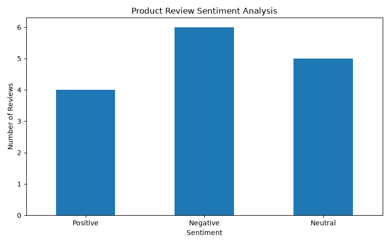

# Product Review Sentiment Analysis

## Project Overview
This project analyzes customer product reviews using Natural Language Processing (NLP) and classifies them into Positive, Negative, and Neutral sentiments.

## Objectives
- Analyze customer reviews.
- Identify positive, negative, and neutral opinions.
- Calculate sentiment scores using VADER.
- Generate a sentiment distribution chart.
- Save analyzed results in a CSV file.

## Technologies Used
- Python
- Pandas
- Matplotlib
- VADER Sentiment
- Natural Language Processing (NLP)

## Dataset Description
The project uses a sample dataset of 15 product reviews.

Dataset columns:
- Review_ID
- Product
- Review
- Sentiment

**Note:** The dataset contains sample educational data.

## Methodology
1. Load product review data using Pandas.
2. Initialize the VADER sentiment analyzer.
3. Calculate the compound sentiment score for each review.
4. Classify reviews as Positive, Negative, or Neutral.
5. Save the analyzed results.
6. Generate a bar chart showing sentiment distribution.

## Results

| Sentiment | Number of Reviews |
|---|---:|
| Positive | 4 |
| Negative | 6 |
| Neutral | 5 |
| Total | 15 |

## Sentiment Distribution



## Project Files
- `sentiment_analysis.py` - Main Python source code.
- `product_reviews.csv` - Sample review dataset.
- `sentiment_analysis_results.csv` - Analyzed review results.
- `sentiment_distribution.png` - Sentiment visualization chart.

## How to Run the Project

Install required libraries:

```bash
python -m pip install pandas matplotlib vaderSentiment
```

Run the Python file:

```bash
python sentiment_analysis.py
```

## Conclusion
This project demonstrates how NLP and VADER can be used to analyze customer reviews and identify their sentiment. It helps understand customer opinions about products.

## Project Category
CodeAlpha Internship - Task 4: Sentiment Analysis
